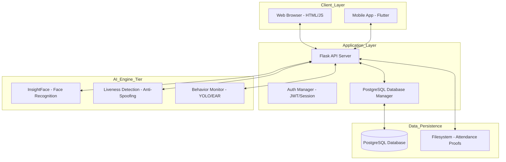

# Project: DeepFace AI Biometric Attendance System

## 1. Problem Statement
The traditional manual attendance process in educational and corporate environments is plagued by several inefficiencies:
- **Proxy Attendance**: Students/employees marking attendance for absent peers.
- **Time Inefficiency**: A significant portion of lecture or meeting time is wasted on manual roll calls.
- **Inaccurate Data**: Human errors during manual entry lead to unreliable records.
- **Lack of Monitoring**: No mechanism to track engagement or behavior (e.g., sleeping or phone usage) during sessions.
- **Reporting Burden**: Generating periodic reports manually is labor-intensive and prone to delay.

## 2. Solution Overview
The **DeepFace AI Biometric Attendance System** provides a robust, automated solution using state-of-the-art Computer Vision and Artificial Intelligence.
- **Automated Recognition**: Instant attendance marking via live camera feed or class photo uploads.
- **Anti-Spoofing (Liveness Detection)**: Prevents bypass using photos or screen replays.
- **Behavior Monitoring**: Real-time detection of student engagement levels (sleep detection) and policy violations (phone usage).
- **Cross-Platform Accessibility**: A centralized backend serving both a web-based admin/teacher portal and a mobile Flutter application.
- **Secure Data Management**: Encrypted storage of user profile data and biometric embeddings in a PostgreSQL database.

## 3. Architecture & Flow

### System Architecture
The system follows a tiered architecture designed for performance and scalability:

### Attendance Workflow
1.  **Capture**: Live camera feed captures frames at 30 FPS.
2.  **Preprocessing**: Frames are optimized, quality-checked (blur/angle), and aligned.
3.  **Liveness Check**: FFT analysis and Specular highlight checks ensure the person is physically present.
4.  **Recognition**: InsightFace extracts 512D embeddings and matches them against the PostgreSQL database.
5.  **Validation**: Rules-based matching (Strict Threshold + Margin Match) prevents false positives.
6.  **Recording**: Attendance is logged with a timestamp, subject, and a screenshot as proof.

---

## 4. Tech Stack

### Backend
- **Core**: Python 3.10+
- **Framework**: Flask (RESTful API)
- **Concurrency**: Singleton Pattern for AI Model loading to minimize memory footprint.

### AI & Computer Vision
- **InsightFace (buffalo_l)**: High-accuracy face detection and 512D embedding extraction.
- **OpenCV**: Image processing, video streaming, and FFT analysis.
- **YOLO (You Only Look Once)**: Real-time object detection for mobile phone usage monitoring.
- **EAR (Eye Aspect Ratio)**: Facial landmark-based sleep detection algorithms.
- **CUDA/ONNX**: GPU acceleration for real-time inference.

### Frontend
- **Web**: HTML5, Vanilla CSS3 (Glassmorphism UI), JavaScript.
- **Mobile**: Flutter (Dart) for student and teacher mobile dashboards.

### Database & Storage
- **Database**: PostgreSQL (Relational data + Face Embeddings).
- **Security**: `pgcrypto` for password hashing and secure biometric storage.
- **Storage**: Local filesystem for high-resolution enrollment photos and attendance proof images.

---

## 5. Implementation Details

### A. Biometric Engine (`biometric_logic.py`)
- **Dual-Model Approach**: Uses a fast model (320px) for live video and a high-res tiled model (960px) for group photo analysis.
- **Standardization**: All faces undergo rotation correction, CLAHE enhancement, and L2 normalization before matching.
- **Clustering**: Students are enrolled with multiple samples; the system computes a "centroid" embedding for maximum accuracy.

### B. Anti-Spoofing Logic
- **Moiré Detection**: Uses Fast Fourier Transform (FFT) to detect high-frequency patterns typical of LCD screens.
- **Specular Detection**: Identifies concentrated light reflections caused by phone screens vs. human skin.
- **Temporal Consistency**: Compares Mean Squared Error (MSE) across frames to detect static photos.

### C. Database Schema Highlights
- **`users` Table**: Stores academic hierarchy (Dept/Year/Sem) and roles.
- **`face_embeddings` Table**: Binary storage of float vectors linked to user IDs.
- **`attendance` Table**: Tracks status (Present/Absent/Late), subject, and links to proof images on disk.
- **`behavior_violations` Table**: Logs types of violations (phone/sleep) with confidence scores.

### D. Classroom Monitoring
- **Tiled Detection**: For group photos, the system splits images into a 3x3 grid to detect even small/distant faces, merging results using Non-Maximum Suppression (NMS).
- **Auto-Absenteeism**: Automatically marks students absent if they are not detected in a class session scan.

---

## 6. How to Run & Deploy

### Prerequisites
- Python 3.10+
- PostgreSQL
- Webcam or IP Camera access

### Setup Steps
1.  **Clone Repo**: `git clone <repository_url>`
2.  **Environment**: Create `.env` with `DB_HOST`, `DB_USER`, `DB_PASSWORD`.
3.  **Install Deps**: `pip install -r requirements.txt`
4.  **Init DB**: Run `backend/full_schema_seed.sql` in PostgreSQL.
5.  **Start Server**: `python -m backend.main`

---
*Documentation generated for the DeepFace Attendance System project.*
